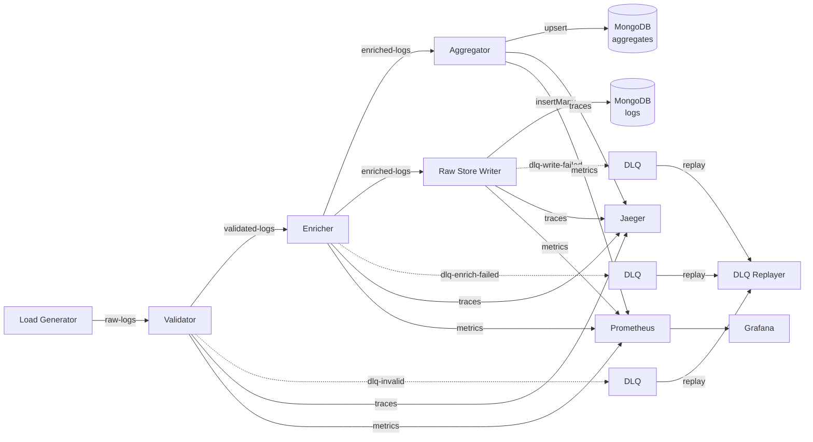

# Distributed Collector

A high-throughput, event-driven log processing pipeline built in Go. It ingests structured JSON application logs at **100K events/sec**, validates and enriches them through a multi-stage Kafka pipeline, computes rolling aggregates, and persists results to MongoDB — with full distributed tracing, Prometheus metrics, and dead-letter queue handling.

Designed as a portfolio showcase of production-grade distributed systems patterns: backpressure, batch writes, poison-pill detection, horizontal scaling, and observability.

## Architecture



Each stage is an independently deployable Go service. Events flow through Kafka topics, enabling horizontal scaling, clear failure boundaries, and end-to-end distributed traces in Jaeger.

See [docs/architecture.md](docs/architecture.md) for detailed system design, data flow, and scaling strategy.

## Quick Start

**Prerequisites:** Docker, Docker Compose, and Go 1.25.8+ (for local builds).

```bash
git clone https://github.com/widasinnacy/distributed-collector.git
cd distributed-collector

# Start the full stack (Kafka, MongoDB, Jaeger, Prometheus, Grafana, pipeline services)
make up

# Open observability UIs
# Grafana:    http://localhost:3000  (admin / admin)
# Jaeger:     http://localhost:16686
# Prometheus: http://localhost:9090
```

Grafana is provisioned automatically: the Prometheus datasource and the pipeline dashboard (`dashboards/grafana-pipeline.json`) load on startup — open **Dashboards → pipeline**.

### Host ports

Kafka and MongoDB are published on non-default host ports so they don't clash with a locally installed Kafka/MongoDB. Inside the Docker network services use the standard ports.

| Service | Host | Inside Docker network |
|---------|------|-----------------------|
| Kafka | `localhost:9082` | `kafka:29092` |
| MongoDB | `localhost:27027` | `mongodb:27017` |
| Prometheus | `localhost:9090` | `prometheus:9090` |
| Grafana | `localhost:3000` | — |
| Jaeger UI / OTLP | `localhost:16686` / `4317` | `jaeger:4317` |
| Service `/metrics`, `/health` | — | `<service>:8081` |

Pipeline services wait for the Kafka healthcheck before starting. ZooKeeper is internal only.

## Run Load Test

Generate synthetic log traffic through the full pipeline:

```bash
# loadgen sits behind the `loadtest` profile, so `up --build` does NOT rebuild it — build it explicitly
docker compose -f deploy/docker/docker-compose.yaml --profile loadtest build loadgen
docker compose -f deploy/docker/docker-compose.yaml --profile loadtest up --force-recreate loadgen
```

Check events are flowing (every stage should report a non-zero rate):

```bash
curl -s localhost:9090/api/v1/query --data-urlencode 'query=sum by (stage)(rate(pipeline_events_processed_total[1m]))'
```

For higher throughput locally:

```bash
make build
./bin/loadgen --mode=steady --rate=100000 --duration=60s --kafka-brokers=localhost:9082 --topic=raw-logs
```

Load generator modes: `steady`, `burst`, `ramp`, `chaos`, and `vegeta` (HTTP ingestion). See `cmd/loadgen/main.go` for all flags.

## Tech Stack

| Component | Technology |
|-----------|------------|
| Language | Go 1.25.8+ |
| Messaging | Apache Kafka (IBM Sarama client) |
| Database | MongoDB 7 (mongo-driver v2) |
| Tracing | OpenTelemetry SDK + Jaeger |
| Metrics | OpenTelemetry → Prometheus |
| Dashboards | Grafana |
| Containers | Docker multi-stage (distroless runtime) |
| Orchestration | Kubernetes + HPA (consumer-lag autoscaling) |
| Load Testing | Custom Go CLI |
| Percentiles | T-Digest (aggregator) |
| Linting | golangci-lint |

## Design Decisions

### Why Kafka?

Kafka decouples pipeline stages so each service scales independently. Partitioning by service name keeps related events ordered while allowing parallel consumption. Consumer groups provide at-least-once delivery with offset tracking, and DLQ topics isolate failures without blocking the main pipeline.

### Why MongoDB?

MongoDB handles two write patterns well: high-volume append-only inserts (raw logs via `InsertMany`) and idempotent upserts (minute-level aggregates via `UpdateOne` with upsert). TTL indexes on `expires_at` enforce tiered retention (7–90 days) without application-level cleanup.

### Partition Strategy

Ingestion topics (`raw-logs`, `validated-logs`, `enriched-logs`) use 12 partitions keyed by service name. This balances load across consumers while preserving per-service ordering. DLQ topics use 3 partitions — lower volume, less parallelism needed. (In Docker Compose, topics are auto-created with `KAFKA_NUM_PARTITIONS: 12`, so DLQs get 12 there too.)

### Concurrency & Backpressure

Every service follows the same internal pattern:

```
Kafka Consumer → Bounded Channel (64) → Worker Pool (64) → Async Producer
```

When the channel fills, the consumer pauses fetching, creating natural backpressure through the broker. Worker pool utilization and consumer lag are exposed as Prometheus metrics for HPA scaling.

### Dead-Letter Queues

Failed events are wrapped in a structured DLQ envelope with error classification (permanent, transient, rate-limited). Events retried 3+ times become poison pills and route to `dlq-poison`. The `dlq-replayer` CLI republishes events back to their origin topic for manual recovery.

### Observability

W3C Trace Context propagates through Kafka message headers. Each service creates an OpenTelemetry span, producing end-to-end traces in Jaeger. Metrics are exported via the OpenTelemetry Prometheus exporter on each service's `:8081/metrics`; Prometheus discovers every replica via DNS. Currently recorded: `pipeline_events_processed_total{stage,status}` and `pipeline_event_latency_seconds` (throughput, error rate, latency panels). Consumer lag, worker utilization, DLQ rate, and MongoDB write duration are defined in `internal/telemetry/metrics.go` but not yet recorded, so those panels stay empty.

## Repository Structure

```
distributed-collector/
├── cmd/
│   ├── validator/           # Schema validation stage
│   ├── enricher/            # Metadata enrichment stage
│   ├── aggregator/          # Rolling aggregate computation
│   ├── raw-store-writer/    # Batch log persistence
│   ├── loadgen/             # Synthetic load generator
│   └── dlq-replayer/        # DLQ event replay CLI
├── internal/
│   ├── kafka/               # Consumer/producer wrappers, trace headers
│   ├── mongo/               # Client, batch writer, connection pool
│   ├── telemetry/           # OTel tracing, metrics registration
│   ├── config/              # Environment-based configuration
│   ├── model/               # Event structs, DLQ envelope, aggregates
│   ├── dlq/                 # DLQ routing, poison-pill detection
│   ├── pipeline/            # Worker pool, health HTTP server
│   ├── validator/           # Validation logic
│   ├── enricher/            # Enrichment + service registry
│   ├── aggregator/          # T-Digest windows, flush logic
│   └── loadgen/             # Synthetic event generation
├── deploy/
│   ├── docker/              # Dockerfiles, docker-compose.yaml, prometheus.yml
│   └── k8s/                 # Kubernetes manifests with HPA
├── configs/
│   └── service-registry.yaml
├── dashboards/
│   └── grafana-pipeline.json
├── docs/
│   └── architecture.md
├── Makefile
├── go.mod
└── README.md
```

## Development

```bash
# Build all services
make build

# Run tests (with race detector)
make test

# Lint
make lint

# Start stack
make up

# Tear down (including volumes)
make down

# Deploy to Kubernetes
make k8s-deploy
```

## Benchmark Results

Target: **100K events/sec** sustained throughput with **P95 end-to-end latency < 100ms**.

Run a benchmark and inspect results:

```bash
make bench
# Reports written to ./benchmarks/report-{timestamp}.json and .md
```

After running a load test, open the Grafana dashboard to view real-time throughput, latency percentiles, consumer lag, and DLQ rates.

## Troubleshooting

| Symptom | Cause / fix |
|---------|-------------|
| `go.mod requires go >= 1.25.8` during build | Dockerfiles must use `golang:1.25-alpine` or newer. |
| loadgen: `connection refused` to `kafka:29092` | Kafka still starting; services now wait on its healthcheck. Retry once `docker compose ps` shows kafka `(healthy)`. |
| `network ... not found` when starting loadgen | Stale loadgen container from before `down`. Use `--force-recreate`, and tear down with `--profile loadtest down`. |
| Prometheus targets up, but dashboard shows 0 / no data | loadgen image is stale — rebuild it with `--profile loadtest build loadgen`. Consumers start at the newest offset, so messages produced before they joined are skipped. |
| ~50% of events in `dlq-enrich-failed` | loadgen emits 20 services, `configs/service-registry.yaml` lists 10; unknown services fail enrichment. |

## License

MIT
