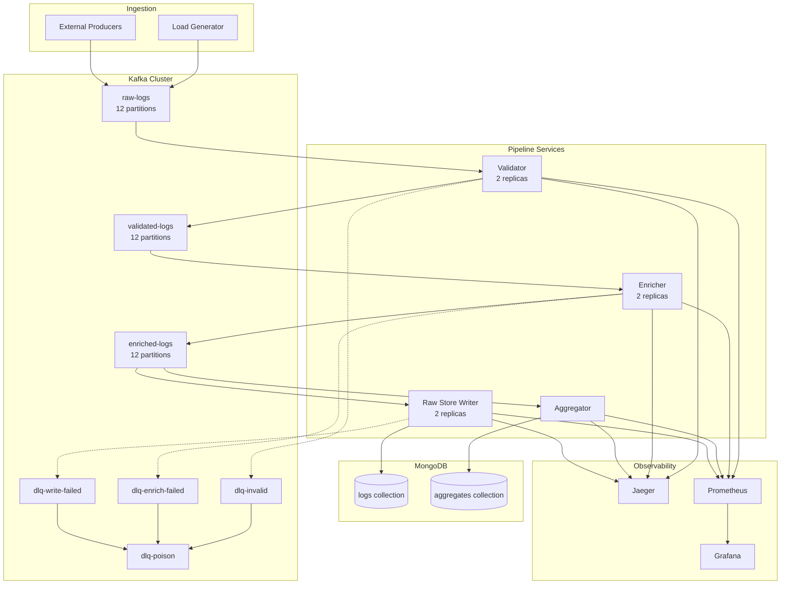
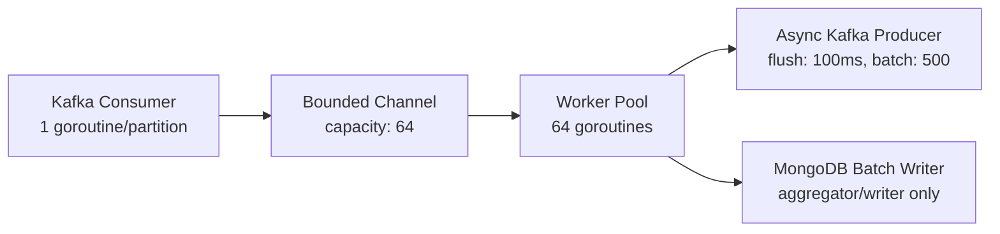
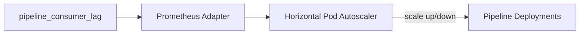

# Distributed Collector — Architecture

This document describes the full system architecture of the Distributed Collector pipeline: service boundaries, data flow, concurrency model, failure handling, storage design, observability, and scaling strategy.

## System Overview

The Distributed Collector is a multi-service event pipeline that processes structured application logs at high throughput (~100K events/sec). Each processing stage is a separate Go microservice communicating exclusively through Kafka topics.

```
Producers → [raw-logs] → Validator → [validated-logs] → Enricher → [enriched-logs] → Aggregator → MongoDB (aggregates)
                                                                                    → Raw Store Writer → MongoDB (logs)
```

Dead-letter queue (DLQ) topics branch off at each stage for events that cannot be processed. A CLI replayer tool can republish DLQ events back into the pipeline.

## Service Architecture



### Service Responsibilities

| Service | Input Topic | Output | DLQ Topic | Scaling |
|---------|-------------|--------|-----------|---------|
| **Validator** | `raw-logs` | `validated-logs` | `dlq-invalid` | Stateless, linear with replicas |
| **Enricher** | `validated-logs` | `enriched-logs` | `dlq-enrich-failed` | Stateless, linear with replicas |
| **Aggregator** | `enriched-logs` | MongoDB `aggregates` | — | Single consumer group, partition-bound |
| **Raw Store Writer** | `enriched-logs` | MongoDB `logs` | `dlq-write-failed` | Batch-writer, scales with replicas |
| **Load Generator** | — | `raw-logs` | — | On-demand (load test profile) |
| **DLQ Replayer** | DLQ topics | Origin topics | `dlq-poison` | CLI, manual invocation |

## Data Flow

### Stage 1: Validation

The validator receives raw JSON log events from the `raw-logs` topic and performs schema validation:

- **Required fields:** `timestamp` (ISO 8601), `service` (non-empty, max 128 chars), `level` (DEBUG/INFO/WARN/ERROR/FATAL), `message` (non-empty)
- **Valid events** → published to `validated-logs`, keyed by service name
- **Invalid events** → wrapped in a DLQ envelope and sent to `dlq-invalid` with error classification `Permanent`

Validation is stateless — each event is processed independently with no shared state.

### Stage 2: Enrichment

The enricher adds metadata from an in-memory service registry (`configs/service-registry.yaml`):

- Normalizes timestamp to UTC
- Adds team owner, service tier, and SLA metadata
- Sets `processed_at`, `hour_bucket`, and `pipeline_version`
- Computes `expires_at` based on service tier (critical: 90d, standard: 30d, debug: 7d)
- **Unknown services** → routed to `dlq-enrich-failed`

### Stage 3a: Aggregation

The aggregator maintains in-memory tumbling windows (per service, per minute):

- Event counts by log level
- P50, P95, P99 latency via T-Digest approximation
- Error rate (ERROR + FATAL / total)
- Top error codes and unique endpoints

Windows flush to MongoDB every 10 seconds (configurable via `FLUSH_INTERVAL_SEC`). Writes use upsert on `{service, bucket}` for idempotency.

### Stage 3b: Raw Storage

The raw store writer batch-accumulates enriched events and writes to MongoDB:

- **Flush trigger:** 1,000 events OR 5 seconds (whichever first)
- **Write method:** `InsertMany` with `ordered: false`
- **Retry:** exponential backoff with jitter (100ms → 500ms → 2s), 3 attempts
- **After retries exhausted** → `dlq-write-failed`

Both the aggregator and raw store writer consume from the same `enriched-logs` topic in separate consumer groups, enabling parallel fan-out without duplication concerns.

## Event Schemas

### Input Event (raw-logs)

```json
{
  "timestamp": "2026-08-13T12:30:00.123Z",
  "service": "payment-service",
  "level": "ERROR",
  "message": "failed to process transaction",
  "trace_id": "abc123def456",
  "span_id": "789ghi",
  "correlation_id": "corr_tx_98765",
  "metadata": {
    "endpoint": "/api/v1/charge",
    "method": "POST",
    "latency_ms": 342,
    "status_code": 500,
    "error_code": "PAYMENT_DECLINED"
  }
}
```

### Enriched Event (enriched-logs)

Adds an `enrichment` block with team, tier, processed timestamp, hour bucket, and pipeline version. Also includes `expires_at` and `retention_tier` for TTL enforcement.

### DLQ Envelope

```json
{
  "original_event": { },
  "error": {
    "stage": "validator",
    "error_type": "SCHEMA_VIOLATION",
    "error_message": "field 'timestamp' is not valid ISO 8601",
    "failed_at": "2026-08-13T12:30:01.456Z",
    "retry_count": 0,
    "retry_history": [],
    "poison_pill": false,
    "service_instance": "validator-pod-abc123"
  }
}
```

## Kafka Topic Design

| Topic | Partitions | Key | Purpose |
|-------|-----------|-----|---------|
| `raw-logs` | 12 | service name | Ingestion |
| `validated-logs` | 12 | service name | Post-validation |
| `enriched-logs` | 12 | service name | Post-enrichment |
| `dlq-invalid` | 3 | — | Schema validation failures |
| `dlq-enrich-failed` | 3 | — | Enrichment failures |
| `dlq-write-failed` | 3 | — | MongoDB write failures |
| `dlq-poison` | 3 | — | Events with 3+ failed replay attempts |

Partitioning by service name ensures:
- Events from the same service stay ordered within a partition
- Consumer groups can scale up to the partition count
- Load is spread across partitions for high-cardinality service fleets

## Concurrency Model

Every pipeline service follows the same internal architecture:



### Backpressure Mechanism

1. **Channel-based flow control:** When the bounded channel (default 64) fills, the Kafka consumer blocks on send, pausing partition fetching.
2. **Broker backpressure:** Paused fetching creates TCP backpressure to the Kafka broker, slowing upstream producers naturally.
3. **Producer backpressure:** Workers block when the async producer buffer (10K messages) is full.
4. **Graceful degradation:** MongoDB failures route events to DLQ rather than crashing the service.

### Graceful Shutdown Sequence

1. Receive SIGINT/SIGTERM
2. Stop Kafka consumer (leave consumer group cleanly)
3. Drain the worker channel (process remaining in-flight events)
4. Flush async producer buffer
5. Flush MongoDB write buffer (aggregator/writer)
6. Close connections and exit

## Dead-Letter Queue Strategy

### Error Classification

| Class | Behavior | Examples |
|-------|----------|----------|
| **Permanent** | No retry, immediate DLQ | Schema violations, unknown fields |
| **Transient** | Exponential backoff, 3 attempts | Timeouts, connection errors |
| **RateLimited** | Fixed 5s interval retry | Upstream/downstream rate limits |

### Poison-Pill Detection

Events with `retry_count >= 3` are classified as poison pills. They route directly to `dlq-poison` and are never retried again. Full `retry_history` is preserved for audit and debugging.

### DLQ Replayer

The `dlq-replayer` CLI tool:
1. Consumes events from a specified DLQ topic
2. Checks retry count (routes to poison if >= 3)
3. Republishes the original event to the origin topic
4. Increments `retry_count` and appends to `retry_history`

## MongoDB Schema

### Collection: `logs`

Stores enriched log events with TTL-based retention.

**Key fields:** `timestamp`, `service`, `level`, `message`, `trace_id`, `correlation_id`, `metadata`, `enrichment`, `expires_at`, `retention_tier`, `ingested_at`

**Indexes:**
- `{ service: 1, timestamp: -1 }` — logs by service
- `{ level: 1, timestamp: -1 }` — errors by time
- `{ trace_id: 1 }` — trace correlation
- `{ correlation_id: 1 }` — cross-service grouping
- `{ expires_at: 1 }` with `expireAfterSeconds: 0` — TTL auto-deletion

**Write strategy:** `InsertMany`, `ordered: false`, batch size 1,000

### Collection: `aggregates`

Stores minute-level rolling aggregates per service.

**Key fields:** `service`, `bucket` (minute timestamp), `counts`, `latency` (p50/p95/p99), `error_rate`, `unique_endpoints`, `top_errors`, `computed_at`

**Indexes:**
- `{ service: 1, bucket: -1 }` unique compound
- `{ bucket: -1 }` — global time range queries
- `{ error_rate: -1, bucket: -1 }` — highest error rates

**Write strategy:** `UpdateOne` with `upsert: true` on `{ service, bucket }`

### TTL by Service Tier

| Tier | Retention |
|------|-----------|
| `critical` | 90 days |
| `standard` | 30 days |
| `debug` | 7 days |

The enricher computes `expires_at` at ingestion time. MongoDB's TTL index handles automatic deletion.

## Observability

### Distributed Tracing

Trace context propagates via W3C Trace Context in Kafka message headers. Each service creates an OpenTelemetry span:

```
Producer (create trace) → Validator (span) → Enricher (span) → Aggregator (span)
                                                              → Raw Store Writer (span)
```

Traces are exported via OTLP gRPC to Jaeger. View end-to-end event journeys at `http://localhost:16686`.

### Metrics

All services expose OpenTelemetry metrics scraped by Prometheus:

| Metric | Type | Labels | Purpose |
|--------|------|--------|---------|
| `pipeline_events_processed_total` | Counter | `stage`, `service`, `status` | Throughput tracking |
| `pipeline_event_latency_seconds` | Histogram | `stage` | End-to-end latency |
| `pipeline_batch_size` | Histogram | `stage`, `target` | Batch write efficiency |
| `pipeline_consumer_lag` | Gauge | `stage`, `partition` | Backlog monitoring |
| `pipeline_dlq_events_total` | Counter | `stage`, `error_type` | Failure tracking |
| `pipeline_mongo_write_duration_seconds` | Histogram | `collection`, `operation` | Storage performance |
| `pipeline_worker_pool_utilization` | Gauge | `stage` | Capacity planning |

A pre-built Grafana dashboard (`dashboards/grafana-pipeline.json`) visualizes all seven metric categories.

### Structured Logging

All services use Go `slog` with JSON output. Log lines include `trace_id` for correlation with Jaeger traces.

## Deployment

### Docker Compose (Local Development)

```bash
make up   # Starts Kafka, MongoDB, Jaeger, Prometheus, Grafana, all pipeline services
make down # Tear down including volumes
```

Services run as multi-stage Docker builds with distroless runtime images. The load generator is available via the `loadtest` compose profile.

### Kubernetes (Production)

```bash
make k8s-deploy
```

Manifests in `deploy/k8s/` include:
- Namespace: `distributed-collector`
- ConfigMap with shared environment variables
- Deployments for all four pipeline services (2 initial replicas)
- HPA scaling on `pipeline_consumer_lag` (min: 2, max: 10, threshold: 10,000)

### HPA Scaling Strategy



When consumer lag exceeds 10,000 messages for 30 seconds, HPA adds replicas up to the partition count (10 max). Scale-down occurs when lag drops below threshold for 5 minutes.

## Load Testing

The load generator (`cmd/loadgen`) supports multiple modes:

| Mode | Behavior |
|------|----------|
| `steady` | Constant rate indefinitely |
| `burst` | Alternates 10K/s and 150K/s every 30s |
| `ramp` | Linear increase from 0 to target over N seconds |
| `chaos` | Random services, error rates, payload sizes |
| `vegeta` | HTTP load against ingestion endpoint |

Synthetic data includes 20 fake services, realistic log level distribution (70% INFO, 15% WARN, 10% ERROR), log-normal latency values, and ~2% intentionally invalid events for DLQ testing.

Benchmark reports are written to `./benchmarks/report-{timestamp}.json` and `.md`.

## Success Criteria

1. Sustain 100K events/sec through the full pipeline on a single machine (Docker Compose)
2. End-to-end latency P95 < 100ms (Kafka produce to MongoDB write)
3. Zero data loss under normal operation (all events stored or in DLQ)
4. Graceful handling of MongoDB outage (events route to DLQ, pipeline doesn't crash)
5. Horizontal scaling via K8s HPA responding to consumer lag
6. Full distributed trace visible in Jaeger for any event's journey
7. Grafana dashboard shows real-time pipeline health
8. README enables a reviewer to run the full system in under 3 minutes
